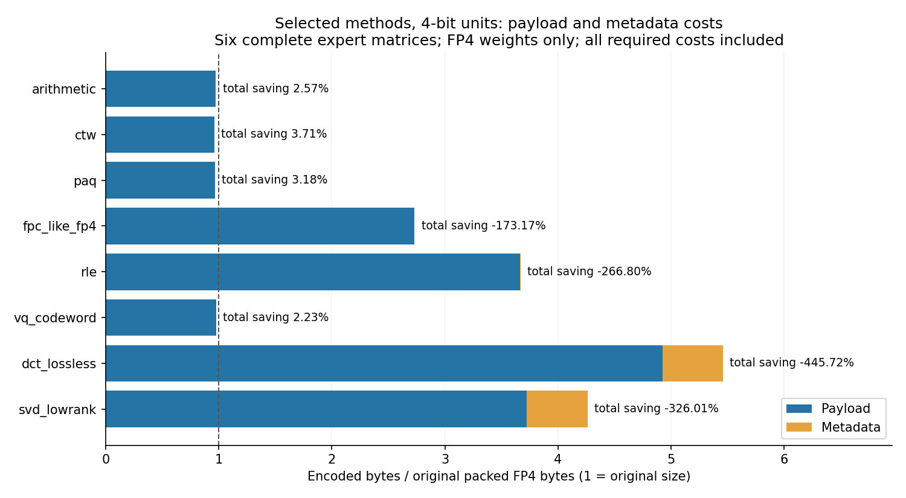
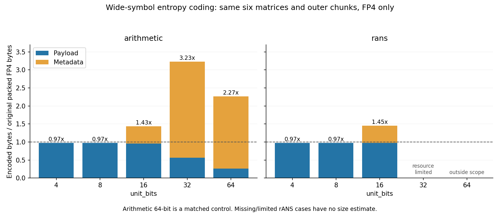

# 跨对话协作

Git 仓库保存两边共享的事实，不依赖聊天历史。先读 [README](../README.md)、[开发说明](开发说明.md) 和 [AGENTS](../AGENTS.md)。

## 当前交接点

- A～D 已接入59个方法id，包含3个仅供FP8/BF16的指数分离对照、两种VQ适配和Inter-frame复用别名；目录记录不等于完成全模型。
- README 每技术一行，注明原生机制/适配方式、FP4 Payload节省率、总节省率及抽样/全模型范围；不要混用不同范围。
- 最新统一抽样：同一层相邻专家0/1的完整w1/w2/w3，共6张FP4矩阵，35,389,440权重字节，独立scale另计；外层1 MiB上限，共36块，逐矩阵/组件独立编码。
- 连续word实验共202配置；201配置的7,236个方法×块逐字节验证通过。rANS32的36块因已出现符号超过65,536种而资源受限，大小/收益为空。JPEG-LS8/16扩容修正已重跑通过。
- 70项Python测试通过，另有1,280次宽整数路径ASan/UBSan往返检查；这是当前已测范围，不代表所有输入或所有配置已经证明正确。
- 历史36个64 KiB跨层片段及VQ参数探索保留在`experiments/fp4-sample/`，该报告含独立scale，不能替代当前完整矩阵FP4结果。

当前没有新一轮模型实验规格；读取此仓库不代表授权启动模型运行。

## 结果入口

| 文件 | 内容 |
| --- | --- |
| [FP4总表](../experiments/fp4-results.csv) | 与README对应的55行技术摘要，分别注明数据来源与范围 |
| [分组实验报告](../experiments/grouped-units/report.md) / [JSON](../experiments/grouped-units/results.json) | 同一组矩阵、各word宽度的参数、逐流成本、Payload/总节省率、相对算术净收益和限制 |
| [分组支持清单](../experiments/grouped-units/audit.md) | 真实扩展、格式适配、等价项和待复核边界 |
| [完整矩阵报告](../experiments/fp4-module/report.md) | 普通4-bit配置；逐矩阵明细与验证记录在同目录 |
| [历史报告](../experiments/fp4-sample/report.md) | 原36片段与14组VQ探索，含全部候选和对照 |

图由已有分组汇总生成，不读取模型。两图使用相同的6张矩阵；第一图只展示指定代表方法，不替代完整表：

## 运行与发布边界

首次构建：复制`.env.example`为`.env`并设置本地数据路径；按开发说明分别执行`build_native.py`、`build_predictive.py`、`build_shared_patterns.py`、`build_math_structure.py`、`build_codeword_vq.py`、`build_grouped_units.py`、`build_grouped_jpeg.py`。均位于`scripts/`，使用已收录的上游源码离线编译；不要改写旧结果。

合成检查：`PYTHONPATH=src python3 -m unittest discover -s tests`。模型运行需对应规格明确授权。
仅刷新最新报告：`python3 scripts/run_grouped_sample.py report`；此操作读取服务器本地`runs/`，不重新编码模型。
图表可通过`python3 scripts/plot_results.py`从已提交的JSON重新生成，需要可选依赖Matplotlib。

仓库发布代码、第三方来源/许可证、规格及小型CSV/JSON/Markdown/图片摘要。
`.env`、模型、构建产物、23 GB本地`runs/`和大块级诊断不上传，也不删除。
`runs/`中的SQLite、频率表及状态保留在服务器；已提交摘要中的本地路径用于溯源，不代表远端也拥有这些文件。
当前结果不包含推理加速测试；共享码表尚未实现，Payload高节省不能独立证明存在可利用冗余。

## 每一步怎样交接

后续一项实验一份`specs/NNN-任务名称.md`，最少写清：目的；输入与分组/分块；完整技术及固定参数；匹配基线；计费、解码验证和输出字段；允许的执行范围。
实现方按规格提交代码和自解释摘要，并在该规格末尾填写完成状态、结果文件、验证与限制。汇总应包含原始packed大小、各编码流、元数据、总大小、Payload/总节省率及适用时的匹配基线净收益；失败不得填零。
每次提交同步README进度。两边通过仓库URL、分支和commit定位同一个版本，GitHub仓库授权与对话挂载由使用者完成。
