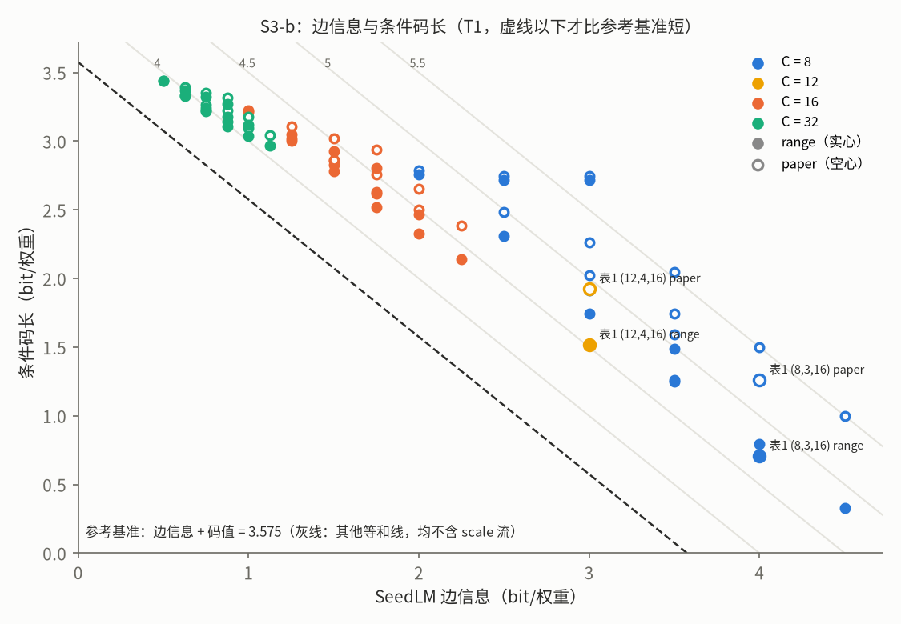

# 012：SeedLM 与 BB-ANS 的复现及 FP4 实验

规格见 [docs/012-SeedLM与BB-ANS复现.md](../../docs/012-SeedLM与BB-ANS复现.md)；用时估计与记录见 [results/timing.md](results/timing.md)；论文与代码来源见 [refs.md](refs.md)。

缩写：
- SeedLM：用伪随机数发生器的种子压缩权重的方法（Shafipour 等，ICLR 2025）。
- LFSR：线性反馈移位寄存器（linear feedback shift register），SeedLM 用它从种子生成随机矩阵。
- BB-ANS：用非对称数字系统（ANS，asymmetric numeral systems）实现的 bits-back 编码（Townsend 等，ICLR 2019）。
- VAE：变分自编码器（variational auto-encoder）。
- ELBO：证据下界（evidence lower bound）；负 ELBO 是 bits-back 编码码长的期望值。
- 参考基准：008 链式模型 + 011 R9c 在同一批矩阵上的总码长（含 scale 流），T1 上为 3.6056 bit/权重。

## 1. 开源核实（阶段 0，2026-11-21）

| 论文 | 官方代码 | 核实结果 |
|---|---|---|
| BB-ANS | https://github.com/bits-back/bits-back（论文 README 指向此仓库），作者后续的通用库 https://github.com/j-towns/craystack | 两者都可用；本实验 B1 直接运行前者，未作改动。commit 见 refs.md。 |
| SeedLM | 没有 | 再次搜索（Exa）：Apple 的论文页只链接预印本，没有官方仓库。第三方复现有 `qiuyu-ren/seedlm-repro`（按论文文字实现，numpy）、`alexander-camuto/seedlm-sim`（抽头用的是自己的默认值，与论文表 6 不同）、`MyasnikovNA/SeedLM-Reproduction`、`mbarnson/NanoSeedLM`（加了激活校准等改动）。只作对照。 |

论文版本：
- SeedLM：ICLR 2025 会议版（proceedings.iclr.cc）与 arXiv v2。方法部分（LFSR、式 1–3、算法、表 1、表 6）一致。差异：
  - 会议版多了附录 A.3–A.5 三个算法和 A.6 的 GPTQ 对比；
  - arXiv 版表 2 有 QuIP#，会议版没有；
  - 公式编号相差 1（会议版的式 1 是 arXiv 的式 2）。
  按规格以会议版为准，下文的节号、式号、表号都指会议版。
- BB-ANS：arXiv 1901.04866 只有 v1，页眉为 "Published as a conference paper at ICLR 2019"，即会议版。OpenReview 的 PDF 拒绝自动下载，未取得；以 arXiv 版为准。

模型与数据的可得性：
- SeedLM 论文的模型是 Llama 2（7B、13B、70B）和 Llama 3（8B、70B）。Hugging Face 官方仓库 `meta-llama/*` 对本机的账号全部返回 403（需要另行申请许可）。按规格不用非官方镜像，所以 S2 只能做“重建误差层面”的验证，**未完成端到端复现**（见第 3 节）。`meta-llama/Llama-3.1-8B` 可以访问，但它不在论文中，没有可对照的数字，没有使用。
- MNIST：由官方脚本经 torchvision 下载。

## 2. 实现决定与 FP4 适配

### 2.1 实现决定（原文没写清楚、需要选择的地方）

| 编号 | 项目 | 原文怎么说 | 为什么需要决定 | 选择 | 备选 |
|---|---|---|---|---|---|
| S-1 | 种子与 U 的对应 | 图 4 / arXiv 图 3：V(s) 从种子之后的第一个状态开始按行填；算法 2 第 5 步：在缓存的状态序列中从 `s % length` 处截取 | 两种写法给出相同的候选矩阵集合，但同一个整数 s 对应的矩阵不同；结果只在并列时不同 | 按图 4 与算法 1：s 是寄存器初值，V(s) 是其后 C·P 个状态按行填入。种子按 1, 2, …, 2^K−1 的顺序搜索（arXiv 第 3.3 节 “s_j := j”），严格小于才更新（算法 3），所以并列时取最小的种子 | 第三方按缓存偏移的顺序取，并列时选的种子不同但重建完全相同（见 3.1） |
| S-2 | 共享指数的取法 | 第 3.2 节：`e = max_i ⌊log2 |t_i|⌋`，再把 t_i/2^e 量化成 4 bit 补码整数；同一段又说可表示范围是 [−8×2^−8, 7×2^7] | 按公式，|t_i|/2^e 落在 [−2, 2)，4 bit 整数只用到 −2…2 五个值，与“4 bit 补码”和所说的范围不一致；没有官方代码 | 两种都实现、都报告：“原文公式”（paper）照印刷的公式；“充满范围”（range）取 `e = ⌈log2(max|t|/7.5)⌉`，即让四舍五入后的整数落在 [−8, 7] 的最小 2 的幂 | 第三方 seedlm-repro 默认用 range，并指出按原文公式误差大 1.55 倍；我们用论文自己的设计空间实验（第 3.4 节）检验哪一种能选出表 1 的配置 |
| S-3 | 指数与整数的取值范围 | 4 bit 指数、4 bit 补码整数；范围 [−8×2^−8, 7×2^7] | 需要具体的截断规则 | e 截到 [−8, 7]，q 截到 [−8, 7]；全零的块 q=0、e=−8 | — |
| S-4 | 舍入方式 | “quantized to a 4-bit 2’s complement integer” | 没说舍入规则 | 四舍五入到最近整数，恰在一半时取偶数（numpy `rint`，与第三方相同） | — |
| S-5 | 伪逆的精度 | 第 3.3 节：预先计算并缓存所有种子的伪逆；附录 A.5：“at most 6.3MB” | 没说精度 | float64 计算、float32 存储。C=8、P=3 时 65535×24×4 字节 = 6.29 MB，与论文的 6.3 MB 相符（C=12、P=4 的 float32 缓存为 12.6 MB，论文的“at most 6.3MB”只对 4 bit 配置成立） | — |
| S-6 | 搜索的算术 | 未说明 | 需要在 GPU 上穷举 2^16 个种子 | Triton 内核，float32；与 float64 伪逆的 numpy 参考实现对照：4 bit 配置选出的种子完全相同，3 bit 配置 97–98% 相同，不同的都是误差相差 < 10^−6 的近似并列 | — |
| S-7 | 分块 | 第 3 节：每个权重矩阵切成 C 个连续元素的块 | 没说按行还是按列 | 按存储顺序（行优先）展平后每 C 个一块；C 不整除行长时块可以跨行（与第三方相同） | — |
| S-8 | 设计空间实验的范围 | 第 3.4 节式 4：在 M·C = K + 4 + 4P 下网格搜索，用标准正态向量 | 没给网格边界、样本数和跨 C 比较的归一化 | C ≤ 16，K 取表 6 中的 2–24，P < C；每个 C 用 4096 个标准正态向量；按每元素均方误差（除以 C）比较 | — |
| B-1 | 表 2 的测试数据量 | “compression rates on the binarized MNIST and full MNIST test sets” | 官方脚本默认只压 200 张、100 张 | 压完整测试集 1 万张；另按图 3 的做法压“三份打乱拷贝的拼接”（3 万张） | — |
| B-2 | 表 2 中的“VAE test ELBO” | 训练结束时的测试 ELBO | 官方 `test()` 在 eval 模式下用 z = 均值（不是采样），不是严格的 ELBO | 两种都报告：官方 `test()` 的值和 20 次采样的蒙特卡洛负 ELBO | — |
| B-3 | 初始比特 | 第 3.2 节：约需 400 bit 的“干净”比特启动链 | 官方脚本给了 20 个（二值）/50 个（原始）随机 32 bit 字 | 照官方脚本给初始字；另外测量第一张图的后验弹出实际消耗的比特数 | — |

### 2.2 FP4 适配

| 编号 | 方法 | 原文的做法 | FP4 上的做法 | 原因 |
|---|---|---|---|---|
| F-S1 | SeedLM 输入 | 从 FP16 权重出发 | 从反量化后的数值（码值 × 2^scale）出发 | 规格指定的唯一输入适配 |
| F-B1 | BB-ANS 数据点 | 一张 28×28 图像 | 一个 MXFP4 块：一行中连续 32 个码值（15 个符号）；块按行优先顺序排列 | 规格指定 |
| F-B2 | 似然 | 二值：伯努利；原始：beta-二项分布 | 每个位置一个 15 类分类分布（解码器输出 32×15 个 logit） | 规格指定 |
| F-B3 | 网络输入 | 像素值 / 255 | 每个码值的有符号 E2M1 等级 / 12（在 [−1, 1] 内，是像素强度的对应物）；块 scale 字节换成 (E − 120)/4 作为编码器和解码器的附加输入 | 规格要求 scale 作附加输入；用数值而不是独热，与原文“直接输入像素值”一致 |
| F-B4 | 网络结构 | 原始 MNIST：编码器、解码器各一个 200 维隐层，潜变量 50 维，带批归一化 | 同一结构（单隐层、批归一化、ReLU），隐层与潜变量维数在训练集上扫描 | 规格允许扩大规模；按验证集负 ELBO 选 |
| F-B5 | 训练 | 官方：Adam，学习率 5e-4，批 100，20 轮，保存最后的参数 | 相同；训练数据为 010 的 24 个训练矩阵的全部 884.7 万个块，随机留出 10% 作验证 | — |
| F-B6 | 编码精度 | 官方原始 MNIST 脚本：先验 8 bit，后验 14 bit，观测 14 bit，初始 50 个随机字 | 相同 | — |
| F-B7 | 并行流 | 官方代码是单条链；Craystack 把消息头做成数组、各元素是独立的 rANS 状态 | N = 1 用官方代码（单条链）；N > 1 用 Craystack：消息头 N 个状态，第 t 步编码第 tN…tN+N−1 个块，每个块占一个状态 | 规格要求两种都做 |
| F-B8 | GPU 解码 | 无 | 神经网络放在 GPU 上，rANS 运算仍是 Craystack 的 numpy（CPU） | Craystack 只有 numpy 实现 |
| F-B9 | B3 混合模型的编码 | 原文只做连续潜变量；Craystack 支持离散潜变量 | 005 的混合模型（每个 E 一个，EM 在被编码的矩阵上拟合，模型成本计入）；先验、后验、观测精度都用 14 bit；不同 E 的类数不同，Craystack 的批量编码把类数补到最大 K，补出的类概率为 0 | 规格指定 B3 用 005 的模型；离散潜变量不需要原文对连续潜变量的先验分桶（8 bit 先验精度是给分桶用的），所以三者统一用官方的观测精度 14 bit |
| F-S2 | SeedLM 无损化 | 原文是有损方法 | 边信息按原文比特数计；以 Ŵ 相对 FP4 格点的区间（16 个区间 × S 个子区间）和 E 作上下文，008 的自适应计数编码真实码值；S 在 8 个训练矩阵上选 | 规格指定“近似 + 残差”与 008 的计数方法；子区间数是规格说的“分档方式在训练集上选” |
| F-S3 | SeedLM 变体 | 表 1 两个配置 | 规格的 36 个变体先用 range 取法；设计空间实验（3.2）显示印刷公式能选出表 1，所以变体再用印刷公式跑一遍 | 两种取法都可能是原文的意思（决定 S-2），都报告 |

## 3. 复现验证

### 3.1 SeedLM S1：按原文实现（`seedlm/slm.py`、`seedlm/seedlm_gpu.py`、`seedlm/s1_check.py`，结果 `results/s1/s1_check.json`）

逐项出处（会议版）：

| 内容 | 出处 | 实现 |
|---|---|---|
| LFSR 更新：反馈位为各抽头位的异或，状态右移一位、反馈位放到最高位；输出的是更新后的状态 | 第 3.1 节；附录 A.3 算法 1 | `slm.lfsr_sequence` 逐行照抄 |
| 抽头（K = 16 时为 0、1、3、12） | 附录 A.1 表 6 | `slm.TAPS`，表 6 全部 23 行 |
| V(s)：种子之后的 C·P 个状态按行填成 C × P | 图 4；附录 A.4 算法 2 第 7 步 | `slm.V_by_seed`（决定 S-1） |
| U(s) = (V(s) − 2^(K−1)) / (2^(K−1) − 1) | 第 3.2 节（arXiv 式 1） | `slm.U_from_V` |
| t = U(s)^+ w；4 bit 补码整数 + 共享 4 bit 指数；误差 ‖w − U(s) t̂‖²；取最小 | 第 3.2、3.3 节，式 1、2，附录 A.5 算法 3 | `slm.search_numpy`（参考）与 `seedlm_gpu.search`（Triton），决定 S-2…S-6 |
| 预先计算并缓存全部种子的伪逆 | 第 3.3 节 | `slm.Codebook` |
| 每元素比特 M = (K + 4 + 4P)/C；配置 4 bit：C=8、P=3、K=16，3 bit：C=12、P=4、K=16 | 式 3；表 1 | `slm.bits_per_element` |
| 权重预处理、按块归一化、异常值处理 | 原文没有 | 不做 |

检查结果：
- 图 4 的例子（K = 3，种子 4）：V(4) = [[2,5],[6,7],[3,1],[4,2]]，与论文一致。
- 表 6 的 23 组抽头全部是最大长度（遍历 2^K − 1 个非零状态）。
- GPU 与 numpy 参考实现（2048 个标准正态块）：4 bit 配置选出的种子 100% 相同；3 bit 配置 97–98% 相同，不同的都是误差相差 < 10^−6 的近似并列。
- 与第三方 `qiuyu-ren/seedlm-repro` 在同样 256 个标准正态块上比较，重建相对误差 ‖W − Ŵ‖/‖W‖ 完全相同（8 位有效数字）：

| 配置 | 指数取法 | 我们 | 第三方 | 种子相同的比例 |
|---|---|---:|---:|---:|
| 4 bit（C=8，P=3，K=16） | range | 0.11979 | 0.11979 | 96.1% |
| 4 bit | paper | 0.18777 | 0.18777 | 87.9% |
| 3 bit（C=12，P=4，K=16） | range | 0.22493 | 0.22493 | 97.7% |
| 3 bit | paper | 0.30424 | 0.30424 | 89.1% |

  种子不同的块都是精确并列：相邻窗口之间有平移关系，例如系数 [1,1,0] 作用于 U(s) 与 [0,1,1] 作用于前移一格的窗口，给出完全相同的重建。我们按论文算法 3 取较小的种子，第三方按缓存偏移取较小的，所以种子编号不同、重建相同。

### 3.2 SeedLM S2：在原文设置上的验证

**端到端（困惑度）：未完成。** 论文的 5 个模型都在 Hugging Face 的 `meta-llama` 官方仓库，本机账号没有访问许可（403），按规格不用镜像。若取得 Llama 2 7B 的许可，可用本实现直接重跑（按 GPU 实测速度，4 bit 配置压缩全部线性层约 3 小时）。

**重建误差层面（与第三方对照，`seedlm/s2_realweights.py`，`results/s1/s2_realweights.jsonl`）：** 用本机缓存中已有的 Qwen3-4B-Instruct-2507 的 14 个权重张量（第 0、18 层的 q/k/v/o 与 gate/up/down），每个取前 32,768 个元素（第三方对 Llama 的取法），两边分别压缩。

| 配置 | 指数取法 | 相对误差中位数（我们） | 相对误差中位数（第三方） | 范围（我们） | 两边重建的最大差 | 指数在下限 −8 的块（中位数） |
|---|---|---:|---:|---|---:|---:|
| 4 bit | range | 0.1242 | 0.1242 | 0.1227–0.1283 | 0 | 45.4% |
| 4 bit | paper | 0.1929 | 0.1929 | 0.1894–0.1999 | 0 | 0.8% |
| 3 bit | range | 0.2268 | 0.2268 | 0.2253–0.2333 | 3×10^−8 | 44.7% |
| 3 bit | paper | 0.3070 | 0.3070 | 0.3039–0.3170 | 0.0066（一个张量中的少数近似并列块） | 0.3% |

第三方在 Llama-2-7B 的 35 个张量上报告的 4 bit（range）相对误差中位数是 0.1234，与这里 Qwen 上的 0.1242 同一水平。

**论文自己的设计空间实验（第 3.4 节式 4，`seedlm/s2_design.py`，`results/s1/s2_design.jsonl`）：** 网格：M ∈ {3, 4}，所有满足 M·C = K + 4 + 4P 的正整数组合，C ≤ 16、K 取表 6 中的 2–24、P < C（M = 4 共 69 个，M = 3 共 58 个）；每个 C 用同一批 4096 个标准正态向量，数值为每元素均方误差（决定 S-8）。

| M | 指数取法 | 全网格（K ≤ 24）最优 | K ≤ 16 内最优 | 表 1 配置的误差 | 表 1 在全网格的名次 | 表 1 在 K ≤ 16 内的名次 |
|---:|---|---|---|---:|---:|---:|
| 4 | paper | C=10, P=3, K=24（0.0259） | C=8, P=3, K=16（0.0363） | 0.0363 | 10 / 69 | 1 / 50 |
| 4 | range | C=13, P=6, K=24（0.0101） | C=10, P=5, K=16（0.0134） | 0.0151 | 24 / 69 | 9 / 50 |
| 3 | paper | C=13, P=3, K=23（0.0707） | C=12, P=4, K=16（0.0936） | 0.0936 | 13 / 58 | 1 / 43 |
| 3 | range | C=16, P=5, K=24（0.0383） | C=12, P=4, K=16（0.0514） | 0.0514 | 11 / 58 | 1 / 43 |

- 不限制 K 时，两种取法下最优的都是 K = 20–24 的配置，表 1 都不是最优。论文说 K = 16 时缓存全部状态只要约 130 KB（第 3.1 节），全文只用 K = 16，所以网格很可能只到 K = 16（论文没有写）。
- 限制 K ≤ 16 时，**按印刷的指数公式（paper），两个比特预算选出的正好都是表 1 的配置**；按“充满范围”的取法（range），3 bit 选出表 1 的配置，4 bit 选出的是 C=10、P=5（误差 0.0134，表 1 的 C=8、P=3 为 0.0151，排第 9）。
- 这说明论文的设计空间实验很可能就是按印刷的公式做的；第三方认为“印刷的公式不可能是作者实际所用”，这里的结果不支持这一点（但印刷的公式确实让重建误差大约 1.6 倍，见 3.1、3.2 节）。所以后文两种取法都报告，以印刷的公式为“原文”，range 为对照。

### 3.3 BB-ANS B1：官方代码复现表 2（`bbans/b1_mnist.py`、`bbans/b1_summary.py`，结果 `results/b1/`）

用官方仓库的 `rans.py`、`util.py`、`torch_vae/*` 与官方训练好的参数（`torch_binary_vae_params_random`、`torch_vae_beta_binomial_params`），设置与官方压缩脚本相同，只把图像数改成整个测试集（决定 B-1）。

| 数据 | 图像数 | BB-ANS（bit/维） | 含初始比特 | 负 ELBO（官方 test） | 负 ELBO（20 次采样） | 码长/负 ELBO − 1 | 论文 BB-ANS / ELBO | 与论文差 | 逐位一致 | 第一张图后验弹出的比特 |
|---|---:|---:|---:|---:|---:|---:|---:|---:|---|---:|
| 二值 MNIST | 10,000 | 0.1940 | 0.1941 | 0.1936 | 0.1939 | +0.08% | 0.19 / 0.19 | +0.0040 | 是 | 284 |
| 二值 MNIST（三份打乱拷贝） | 30,000 | 0.1940 | 0.1941 | 0.1936 | 0.1938 | +0.10% | 0.19 / 0.19 | +0.0040 | 是 | 282 |
| 原始 MNIST | 10,000 | 1.4059 | 1.4061 | 1.3922 | 1.3913 | +1.05% | 1.41 / 1.39 | -0.0041 | 是 | 344 |
| 原始 MNIST（三份打乱拷贝），ppf 修正 | 30,000 | 1.4061 | 1.4062 | 1.3922 | 1.3913 | +1.06% | 1.41 / 1.39 | -0.0039 | 是 | 325 |

- “BB-ANS”是官方脚本的算法：消息总长减去初始的随机字（这些字解码后原样取回），除以像素数；“含初始比特”不减。
- “负 ELBO（官方 test）”是官方 `test()` 在 eval 模式下的值（z 取后验均值）；“20 次采样”是对 q(z|x) 采样 20 次的平均，是真正的负 ELBO。码长与它的相对差用后者。
- 原始 MNIST 三份拷贝的运行，第一次用未修改的官方代码时，在第 21,000–22,000 张之间失败：`util.gaussian_latent_ppf` 用 `norm.ppf` 和 `searchsorted` 求桶号，与 `gaussian_latent_cdf` 的浮点结果在桶边界上不一致，`non_uniform_dec_statfun` 的断言 `start <= cf < start + freq` 不成立（日志 `b1_full_test3x_official_fail.log`）。作者后来的 Craystack 为同一问题加了修正循环（`craystack/codecs/codecs.py` 的 `_gaussian_ppf`，注释称“extremely rare”）。重跑时只把这个修正循环加到官方函数外面（`b1_mnist.py --ppf-fix`）：桶号满足 cdf 条件时不做任何改动，所以其余结果不受影响。
- **通过标准与结论：**
  - 实际码长与论文相差：二值 +0.004、原始 −0.004 bit/维（论文数字只有两位小数），都在 0.02 以内。**通过。**
  - 码长与负 ELBO 的差距：原始 MNIST 1.05%，与论文的“约 1%”一致；二值 MNIST 0.1%（论文两者都写 0.19，差距在两位小数以内）。**通过。**
  - 编码、解码逐位一致，初始字也原样取回。**通过。**
  - 初始比特：官方脚本给 640 bit（二值）、1600 bit（原始）。第一张图的后验弹出实际用掉 284 bit（二值）、344 bit（原始），与论文说的“约 400 bit”同一量级。

## 4. FP4 结果

### 4.1 BB-ANS B2：VAE + BB-ANS（`bbans/fp4vae.py`、`b2_train.py`、`b2_code.py`、`b2_streams.py`，结果 `results/b2/`）

**训练（官方设置，规模扫描，`results/b2/train.jsonl`）：** 010 的 24 个训练矩阵共 884.7 万个块，随机 90% 训练、10% 验证。验证集负 ELBO（bit/权重，单次采样，批归一化用 eval 模式）：

| 隐层 | 潜变量 | 参数量 | 20 轮后验证负 ELBO | 训练用时（7 个同时在一张 GPU 上） |
|---:|---:|---:|---:|---:|
| 100 | 40 | 64,720 | 3.65561 | 1.8 小时 |
| 200（原文规模） | 50 | 134,780 | 3.65564 | 1.9 小时 |
| 500 | 20 | 290,600 | **3.65036** | 2.1 小时 |
| 500 | 50 | 335,780 | 3.65068 | 2.1 小时 |
| 500 | 100 | 411,080 | 3.65607 | 2.1 小时 |
| 1000 | 50 | 670,780 | 3.65055 | 2.1 小时 |
| 2000 | 50 | 1,340,780 | 3.65089 | 2.3 小时 |

- 所有规模在第 1 轮就到了 3.651–3.656，之后 19 轮几乎不动。作为比较，不用潜变量、只按 scale 取每个码值的静态分布（B3 的 K = 1，在 T1 上拟合）是 3.6504；B3 的块类型混合（K = 16）是 3.5784。
- **潜变量没有被使用（后验坍缩）。** 在 20 万个训练块上算 KL 项：选中的模型（隐层 500、潜变量 20）每块 0.35 bit，20 维中只有 1 维的 KL 超过 0.01 bit；原文规模（200/50）每块 0.007 bit，没有一维在用。块类型信息每块约 2.3 bit（B3 的 0.072 bit/权重 × 32），VAE 一点没有拿到。
- 按规格选验证集负 ELBO 最好的：隐层 500、潜变量 20（290,600 个参数，模型文件 sha256 见 `train.jsonl`）。

**扩展（不在原文中，单独标注）：** 为了确认坍缩是不是训练方式造成的，另训练三个同规模（500/20）的变体：
- 原文二值 MNIST 的结构（不带批归一化，官方脚本学习率 1e-3）；
- KL 退火：KL 项的权重在前 5 轮从 0 线性升到 1（常用的防坍缩方法，原文没有）；
- 两者同时用。

| 变体（扩展） | 验证负 ELBO | KL（bit/块） | 在用的潜变量维数（KL > 0.01 bit） |
|---|---:|---:|---:|
| 原文全 MNIST 结构（批归一化，官方设置），500/20 | 3.65036 | 0.35 | 1 / 20 |
| 原文二值 MNIST 结构（无批归一化，学习率 1e-3） | 3.64977 | 0.37 | 1 / 20 |
| 批归一化 + KL 退火 5 轮 | **3.64911** | 0.37 | 1 / 20 |
| 无批归一化 + KL 退火 5 轮 | 3.65904 | 10.38 | 20 / 20 |

- 前三个都坍缩，负 ELBO 只差 0.001。最后一个用上了全部潜变量（每块 10.4 bit 的 KL），但解码器换回的码长不够付这些 KL，负 ELBO 反而高 0.009。
- 即使是最好的变体（KL 退火，3.6491），也只比不用潜变量（3.6504）好 0.0013，远低于 B3 离散潜变量的 0.072。所以在 FP4 块上，原文这种“连续高斯潜变量 + 各位置独立的似然”的 VAE 学不到块类型信息；这不是规模问题（7 个规模都一样），也不是简单的训练技巧能解决的。
- 编码仍按规格用验证集上最好的**原文设置**模型（500/20，3.65036）；扩展变体只作诊断，不进入编码比较。

**编码（选中的模型：原文设置、隐层 500、潜变量 20）：** 每个矩阵独立编码（规格：按目标独立）。块的 scale 由 008 的 scale 流先解出，作为条件。

T1（24 个矩阵）：负 ELBO 3.64946，scale 流 0.03078，参考基准 3.60562，模型成本 0.01642（摊到这些矩阵）/ 8.3e-06（摊到全模型）
| 流数 N | 实现 | 网络所在 | 矩阵数 | 码值部分（实际，含初始比特） | 总码长（+scale） | 相对参考基准（不含模型） | 逐位一致 | 解码（码值/秒） |
|---:|---|---|---:|---:|---:|---:|---|---:|
| 1 | official bits-back | CPU | 24 | 3.64962 | 3.68041 | -0.07479 | 是 | 8,159 |
| 64 | craystack | CPU | 24 | 3.65057 | 3.68136 | -0.07574 | 是 | 166,091 |
| 1,024 | craystack | CPU | 24 | 3.66720 | 3.69798 | -0.09237 | 是 | 389,365 |
| 16,384 | craystack | CPU | 24 | 3.93274 | 3.96352 | -0.35790 | 是 | 402,665 |
| 64 | craystack | CUDA | 2 | 3.64922 | 3.67861 | -0.07122 | 是 | 33,140 |
| 1,024 | craystack | CUDA | 2 | 3.66578 | 3.69517 | -0.08778 | 是 | 307,653 |
| 16,384 | craystack | CUDA | 2 | 3.93171 | 3.96109 | -0.35370 | 是 | 563,204 |

T2（24 个矩阵）：负 ELBO 4.11293，scale 流 0.02793，参考基准 3.62124，模型成本 0.01642（摊到这些矩阵）/ 8.3e-06（摊到全模型）
| 流数 N | 实现 | 网络所在 | 矩阵数 | 码值部分（实际，含初始比特） | 总码长（+scale） | 相对参考基准（不含模型） | 逐位一致 | 解码（码值/秒） |
|---:|---|---|---:|---:|---:|---:|---|---:|
| 1 | official bits-back | CPU | 24 | 4.09310 | 4.12103 | -0.49979 | 是 | 8,142 |
| 64 | craystack | CPU | 24 | 4.10670 | 4.13462 | -0.51338 | 是 | 168,148 |
| 1,024 | craystack | CPU | 24 | 4.12297 | 4.15090 | -0.52965 | 是 | 395,971 |
| 16,384 | craystack | CPU | 24 | 4.38802 | 4.41595 | -0.79471 | 是 | 410,703 |

- 单条链（官方代码）的实际码长与负 ELBO 几乎相等（T1：码值部分 3.64949 bit/权重，负 ELBO 3.64946，差 0.001%），说明 BB-ANS 本身把 VAE 的负 ELBO 兑现了；问题在 VAE 只学到了“按 scale 的静态分布”。
- 单条链用官方代码跑 T1 时，24 个矩阵中有 4 个在后验弹出时触发了和 B1 同样的 `gaussian_latent_ppf` 浮点不一致（日志保存在 `results/b2/code/failed_official/`）；正式结果加了同一个修正（`bbans/official_fix.py`，与 B1 的 `--ppf-fix` 相同）。坍缩后后验接近先验，采样点经常落在桶边界附近，所以比 MNIST 上频繁得多。
- T2 明显更差，原因在 MTP 层（第 40 层）的 6 个矩阵：码值部分 5.19–5.55 bit/权重，而其余 18 个为 3.64–3.68。训练用的是第 0、13、26、39 层，模型按 scale 字节学到的码值分布不适用于 MTP 层（005 的共用模型实验也看到 MTP 层因 scale 范围不同损失很大）。
- 并行流：流数越多，每条流开头的后验弹出越拿不回比特（每条流第一个块的 bits-back 损失），N = 16384 时每个矩阵只有 23 步，损失 0.28 bit/权重。
- 解码速度：CPU 上的单条链是官方纯 Python 实现（每秒约 8,000 个码值）；Craystack 是 numpy 向量化，N 越大越快（每秒 17–40 万个码值）。表中“CUDA”三行只测了 2 个矩阵，而且测量时 GPU 1 同时在跑其他任务。
- **空闲时复测**（GPU 1 上没有其他任务；同样 2 个矩阵 L0.E191.w1、L39.E88.w2；`results/b2/streams/vae_h500_d20_e20_idle.jsonl`，用 `b2_streams.py --suffix=_idle` 单独存放）：码流与之前的运行逐位相同，只有速度变了。

| 流数 N | CPU 解码（码值/秒） | GPU 解码（码值/秒） | CPU 编码 | GPU 编码 |
|---:|---:|---:|---:|---:|
| 64 | 223,851 | 215,507 | 224,094 | 222,216 |
| 1,024 | 501,023 | 588,607 | 1,263,422 | 1,756,371 |
| 16,384 | 526,165 | 653,069 | 1,439,727 | 2,936,466 |

  之前 GPU 版 N = 64 只有每秒 3.3 万个码值，是 GPU 被占用造成的；空闲时 GPU 与 CPU 相当。N 较大时 GPU 快 17–24%，但不到 1.3 倍：网络放在 GPU 上，rANS 部分仍是 Craystack 的 numpy（F-B8），解码时后验弹出、先验压入等每一步都要在 CPU 和 GPU 之间来回传数据，瓶颈在这里而不在网络。

### 4.2 BB-ANS B3（扩展）：离散潜变量——005 的块类型混合模型（`bbans/b3_mixture.py`、`bbans/b3_summary.py`，结果 `results/b3/`）

模型与 005 相同：对每个 scale 值 E 单独拟合一个混合模型，块以概率 π_z 属于类 z，块内 32 个码值独立服从 θ_z（15 个概率）；EM 150 轮、三种初始化取最好；块数不足 500·K 的 E 用更小的 K。模型在被编码的矩阵上拟合，作为边信息计费（每个 E：K × 16 个数 × 16 bit，005 的计法）。BB-ANS 编码：从精确后验 r(z | 块) 弹出 z，用 θ_z 压入 32 个码值，再用 π_E 压入 z。N = 1 用官方代码（`util.bb_ans_append/pop`），N > 1 用 Craystack 的并行消息头；精度 14 bit，初始 50 个随机字。全部实际编码、解码，逐位一致。

T1（24 个矩阵，K = 16）：边际似然码长 3.57839，K = 1（不分类型）3.65044，**块类型的收益 0.07206**（005 用边际似然估计约 0.073）；模型成本 0.00075，scale 流 0.03078，参考基准 3.60562

| 流数 N | 实现 | 码值部分（实际，含初始比特） | 比边际似然多 | 总码长（+模型+scale） | 相对参考基准 | 相对 008 链式模型 | 逐位一致 | CPU 解码（码值/秒） |
|---:|---|---:|---:|---:|---:|---:|---|---:|
| 1 | 官方 bits-back | 3.57892 | +0.00054 | 3.61046 | −0.00484 | +0.04592 | 是 | 13,548 |
| 64 | Craystack | 3.57918 | +0.00079 | 3.61072 | −0.00510 | +0.04566 | 是 | 218,041 |
| 1,024 | Craystack | 3.58491 | +0.00653 | 3.61645 | −0.01083 | +0.03993 | 是 | 387,226 |
| 16,384 | Craystack | 3.67673 | +0.09835 | 3.70827 | −0.10265 | −0.05189 | 是 | 424,041 |

K = 32 几乎一样（边际似然 3.57838，模型成本 0.00145），各 N 都比 K = 16 差 0.001，表略（`results/b3/b3_summary_T1.json`）。

T2（24 个矩阵，K = 16）：边际似然 3.59677，K = 1 3.67211，收益 0.07534；参考基准 3.62124，008 链式模型 3.67437

| 流数 N | 码值部分 | 比边际似然多 | 总码长 | 相对参考基准 | 相对 008 链式模型 | 逐位一致 | CPU 解码（码值/秒） |
|---:|---:|---:|---:|---:|---:|---|---:|
| 1 | 3.59730 | +0.00053 | 3.62600 | −0.00476 | +0.04837 | 是 | 16,182 |
| 64 | 3.59757 | +0.00080 | 3.62627 | −0.00503 | +0.04810 | 是 | 258,834 |
| 1,024 | 3.60358 | +0.00680 | 3.63228 | −0.01103 | +0.04209 | 是 | 458,777 |
| 16,384 | 3.70035 | +0.10358 | 3.72905 | −0.10781 | −0.05468 | 是 | 486,740 |

- **兑现：** 单条链的实际码长只比边际似然多 0.0005 bit/权重，005 估计的约 0.072 的块类型收益（相对 K = 1）用真实编码器完全兑现。T2 上同样成立（0.075），所以不是在 T1 上拟合的假象（本来每个矩阵就是自己拟合、自己付模型成本）。
- **但不超过参考基准：** 参考基准的码值部分是 3.5748（链式模型 + R9c），比混合模型的边际似然 3.5784 还低 0.0036。块类型混合是“块内各码值独立”的模型，链式模型的逐码值上下文加 R9c 已经拿到了同样多甚至更多的信息。
- **与 011 的比较（011 的增益是相对 008 链式模型的，表中最后一列与它同一口径）：** 011 B2（决策树）+0.0558、B3 块内串行 +0.0549、B3 完全并行加粗块标志 +0.036。BB-ANS 混合模型单条链 +0.046，低于 011 B2/B3 的串行版；N = 1024 时 +0.040，略高于 011 的完全并行版 +0.036，但这时每条流仍要串行解 360 个块；N = 16384（每条流 23 步，最接近“完全并行”）时为 −0.052，比 011 的完全并行版差 0.088。
- **并行代价的来源：** 每条流开头没有可以“拿回”的比特，第一个块弹出后验 z 要从初始字里借，借来的部分不再归还；流数越多这部分越大（N = 1024 多 0.006，N = 16384 多 0.098）。这是 BB-ANS 的结构性成本，与 B2 的连续潜变量版本一致。
- **与 B2 比较：** 同样是 BB-ANS、同样的并行方式，离散潜变量版本在 N = 1、64 时比 VAE 好约 0.07（T1，N = 1：3.6105 对 3.6804；B3 含模型成本，B2 不含），差别来自潜变量是否被用上：VAE 后验坍缩，块类型信息为零；混合模型的 0.072 全拿到了。N 越大差距越大（N = 16384 时 3.708 对 3.964），因为 VAE 每条流开头要为 20 维连续潜变量借比特，混合模型只为一个 16 类的离散变量借。

### 4.3 SeedLM S3-a：直接用于 FP4（有损，`seedlm/s3_run.py`，结果 `results/s3/s3a_T1.jsonl`）

输入是反量化后的数值 W = 码值等级 × 2^(E−127)（F-S1），按存储顺序每 C 个一块，用 S1 的实现（Triton 穷举全部 2^K − 1 个种子）求每块的种子、P 个 4 bit 系数和 4 bit 共享指数。指标：
- 每权重比特数 M = (K + 4 + 4P)/C（原文的计算方式，不含 MXFP4 的 scale 字节）；
- 相对均方误差 = ‖W − Ŵ‖² / ‖W‖²；
- 码值不一致率：重建值 Ŵ 按自己块的 scale 四舍五入到最近的 FP4 格点后，与原码值不同的比例；
- “指数在下限”：共享指数被截到 −8 的块的比例（range 取法下小块的系数被迫变粗）。

表 1 的两个配置（4 bit：C = 8、P = 3、K = 16；3 bit：C = 12、P = 4、K = 16）用两种指数取法（决定 S-2）；其余是规格要求的变体（扩展：C ∈ {8, 16, 32}、P ∈ {1, 2, 3, 4}、K ∈ {8, 12, 16}，range 取法；同一组 36 个变体的印刷公式版见本节末）。T1 共 24 个矩阵、2.83 亿权重，数值按权重数加权。

| C | P | K | 指数规则 | 表 1 | bit/权重 | 占 4.25 bit | 相对均方误差 | 码值不一致率 | 指数在下限的块 |
|---:|---:|---:|---|---|---:|---:|---:|---:|---:|
| 8 | 1 | 8 | range |  | 2.0000 | 47.1% | 0.3074 | 77.6% | 25.5% |
| 8 | 1 | 12 | range |  | 2.5000 | 58.8% | 0.2905 | 76.3% | 23.4% |
| 8 | 1 | 16 | range |  | 3.0000 | 70.6% | 0.2902 | 76.3% | 23.4% |
| 8 | 2 | 8 | range |  | 2.5000 | 58.8% | 0.1590 | 68.3% | 26.7% |
| 8 | 2 | 12 | range |  | 3.0000 | 70.6% | 0.0719 | 53.8% | 22.2% |
| 8 | 2 | 16 | range |  | 3.5000 | 82.4% | 0.0353 | 38.9% | 21.0% |
| 8 | 3 | 8 | range |  | 3.0000 | 70.6% | 0.0905 | 57.8% | 26.0% |
| 8 | 3 | 12 | range |  | 3.5000 | 82.4% | 0.0354 | 38.9% | 27.5% |
| 8 | 3 | 16 | paper | 是 | 4.0000 | 94.1% | 0.0364 | 39.2% | 0.1% |
| 8 | 3 | 16 | range | 是 | 4.0000 | 94.1% | 0.0151 | 21.9% | 32.5% |
| 8 | 4 | 8 | range |  | 3.5000 | 82.4% | 0.0492 | 45.1% | 25.6% |
| 8 | 4 | 12 | range |  | 4.0000 | 94.1% | 0.0174 | 24.4% | 32.6% |
| 8 | 4 | 16 | range |  | 4.5000 | 105.9% | 0.0071 | 10.2% | 43.2% |
| 12 | 4 | 16 | paper | 是 | 3.0000 | 70.6% | 0.0930 | 58.6% | 0.0% |
| 12 | 4 | 16 | range | 是 | 3.0000 | 70.6% | 0.0509 | 47.4% | 28.8% |
| 16 | 1 | 8 | range |  | 1.0000 | 23.5% | 0.5516 | 84.9% | 59.5% |
| 16 | 1 | 12 | range |  | 1.2500 | 29.4% | 0.4216 | 81.7% | 28.7% |
| 16 | 1 | 16 | range |  | 1.5000 | 35.3% | 0.3445 | 79.7% | 16.6% |
| 16 | 2 | 8 | range |  | 1.2500 | 29.4% | 0.4403 | 82.5% | 43.9% |
| 16 | 2 | 12 | range |  | 1.5000 | 35.3% | 0.3046 | 78.2% | 29.9% |
| 16 | 2 | 16 | range |  | 1.7500 | 41.2% | 0.2124 | 73.3% | 23.0% |
| 16 | 3 | 8 | range |  | 1.5000 | 35.3% | 0.3698 | 80.5% | 43.1% |
| 16 | 3 | 12 | range |  | 1.7500 | 41.2% | 0.2421 | 75.1% | 31.7% |
| 16 | 3 | 16 | range |  | 2.0000 | 47.1% | 0.1613 | 69.1% | 27.4% |
| 16 | 4 | 8 | range |  | 1.7500 | 41.2% | 0.3106 | 78.3% | 40.9% |
| 16 | 4 | 12 | range |  | 2.0000 | 47.1% | 0.1938 | 71.8% | 32.1% |
| 16 | 4 | 16 | range |  | 2.2500 | 52.9% | 0.1241 | 64.7% | 29.3% |
| 32 | 1 | 8 | range |  | 0.5000 | 11.8% | 0.7471 | 88.2% | 96.8% |
| 32 | 1 | 12 | range |  | 0.6250 | 14.7% | 0.6442 | 86.7% | 81.9% |
| 32 | 1 | 16 | range |  | 0.7500 | 17.6% | 0.5577 | 85.1% | 56.7% |
| 32 | 2 | 8 | range |  | 0.6250 | 14.7% | 0.6802 | 87.5% | 85.1% |
| 32 | 2 | 12 | range |  | 0.7500 | 17.6% | 0.5673 | 85.4% | 62.3% |
| 32 | 2 | 16 | range |  | 0.8750 | 20.6% | 0.4747 | 83.3% | 44.5% |
| 32 | 3 | 8 | range |  | 0.7500 | 17.6% | 0.6341 | 86.5% | 82.7% |
| 32 | 3 | 12 | range |  | 0.8750 | 20.6% | 0.5214 | 84.4% | 64.9% |
| 32 | 3 | 16 | range |  | 1.0000 | 23.5% | 0.4306 | 82.3% | 52.6% |
| 32 | 4 | 8 | range |  | 0.8750 | 20.6% | 0.5926 | 85.8% | 82.1% |
| 32 | 4 | 12 | range |  | 1.0000 | 23.5% | 0.4783 | 83.5% | 64.7% |
| 32 | 4 | 16 | range |  | 1.1250 | 26.5% | 0.3895 | 81.1% | 53.8% |

- 表 1 的 4 bit 配置（range）用 4.0 bit 换来 0.0151 的相对均方误差，但 21.9% 的码值重建后落到别的格点；3 bit 配置 0.0509、47.4%。印刷公式（paper）的相对均方误差大 2.4 倍（4 bit）、1.8 倍（3 bit），与 S1 一致（S1 报的是相对误差的范数比 1.57、1.35，平方后正是 2.5、1.8）。
- 和 MXFP4 本身（4.25 bit，对自己无误差）相比，SeedLM 在 4.0 bit 时只省 0.25 bit（5.9%），却改动了五分之一的码值；它要逼近的是 FP4 已经量化过的数值，没有 FP16 权重那样平滑的分布可以利用。
- 按规格，本阶段不评测模型精度。
- **印刷公式（paper）版的 36 个变体**（扩展，全部结果在 `results/s3/s3a_T1.jsonl`、`s3_summary_T1.json`）：在全部 37 个可配对的 (C, P, K) 上，paper 的相对均方误差都比 range 大，倍数中位数 1.12；C = 8 时差得最多（1.07–3.50 倍，(8, 4, 16) 最大），C = 32 时几乎相同（1.01–1.12 倍）。paper 取法下共享指数几乎从不落到下限（所有配置不超过 0.2% 的块），所以 range 的优势不是来自避开下限，而是来自让系数用满 [−8, 7] 的范围。

### 4.4 SeedLM S3-b：改造成无损（“近似 + 残差”，`seedlm/s3b_lossless.py`、`seedlm/racoder.c`，结果 `results/s3/s3b_T1.jsonl`）

做法（FP4 适配 F-S2）：
- 边信息：S3-a 每块的种子、系数和指数，按原文的 K + 4 + 4P bit 计。
- 解码端先由边信息重建 Ŵ，再按行优先顺序解出真实码值（R10 合并后 15 个符号）。概率用 008 的顺序自适应计数（每个上下文一个 Dirichlet(½) 计数器）。上下文 = (Ŵ/2^(E−127) 在 FP4 格点之间的哪个区间, 块 scale E)。15 个格点把数轴分成 16 个区间；内部的每个区间再等分成 S 个子区间。S ∈ {1, 2, 4, 8, 16} 在 8 个训练矩阵（010 每层第一个专家的 w1、w2）上选，再用到测试矩阵。
- 总码长 = 边信息 + 条件码长 + 008 的 scale 流。净收益 = 参考基准 − 总码长。
- 测试矩阵上实际编码、实际解码（`racoder.c`，16 bit 精度的自适应 rANS），全部逐位一致。

T1 结果，按净收益排序（range 取法的 36 个变体 + 表 1 两个配置的两种取法，共 39 个组合；子区间数一栏是各 S 被选中的矩阵数；paper 取法的 36 个变体见表后）：

| C | P | K | 指数规则 | 子区间数（矩阵数） | 边信息 | 条件码 | 总码长 | 占 4.25 bit | 相对参考基准 | 逐位一致 |
|---:|---:|---:|---|---|---:|---:|---:|---:|---:|---|
| 32 | 1 | 8 | range | 4（24） | 0.5000 | 3.4374 | 3.9682 | 93.4% | -0.3626 | 是 |
| 32 | 1 | 12 | range | 4（24） | 0.6250 | 3.3266 | 3.9824 | 93.7% | -0.3768 | 是 |
| 32 | 1 | 16 | range | 4（24） | 0.7500 | 3.2169 | 3.9977 | 94.1% | -0.3921 | 是 |
| 32 | 2 | 16 | range | 4（24） | 0.8750 | 3.1074 | 4.0132 | 94.4% | -0.4076 | 是 |
| 32 | 2 | 12 | range | 4（24） | 0.7500 | 3.2389 | 4.0196 | 94.6% | -0.4140 | 是 |
| 32 | 2 | 8 | range | 4（24） | 0.6250 | 3.3715 | 4.0273 | 94.8% | -0.4217 | 是 |
| 32 | 3 | 16 | range | 4（24） | 1.0000 | 3.0401 | 4.0709 | 95.8% | -0.4653 | 是 |
| 32 | 3 | 12 | range | 4（24） | 0.8750 | 3.1796 | 4.0854 | 96.1% | -0.4798 | 是 |
| 32 | 3 | 8 | range | 4（24） | 0.7500 | 3.3216 | 4.1024 | 96.5% | -0.4968 | 是 |
| 32 | 4 | 16 | range | 8（24） | 1.1250 | 2.9685 | 4.1243 | 97.0% | -0.5187 | 是 |
| 32 | 4 | 12 | range | 4（24） | 1.0000 | 3.1178 | 4.1485 | 97.6% | -0.5429 | 是 |
| 32 | 4 | 8 | range | 4（24） | 0.8750 | 3.2731 | 4.1789 | 98.3% | -0.5733 | 是 |
| 16 | 1 | 8 | range | 4（24） | 1.0000 | 3.2103 | 4.2411 | 99.8% | -0.6355 | 是 |
| 16 | 1 | 12 | range | 4（24） | 1.2500 | 3.0037 | 4.2845 | 100.8% | -0.6789 | 是 |
| 16 | 2 | 16 | range | 8（24） | 1.7500 | 2.5164 | 4.2972 | 101.1% | -0.6915 | 是 |
| 16 | 2 | 12 | range | 8（24） | 1.5000 | 2.7796 | 4.3103 | 101.4% | -0.7047 | 是 |
| 16 | 2 | 8 | range | 4（24） | 1.2500 | 3.0521 | 4.3329 | 102.0% | -0.7273 | 是 |
| 16 | 3 | 16 | range | 8（24） | 2.0000 | 2.3262 | 4.3570 | 102.5% | -0.7513 | 是 |
| 16 | 1 | 16 | range | 8（24） | 1.5000 | 2.8305 | 4.3613 | 102.6% | -0.7557 | 是 |
| 16 | 3 | 12 | range | 8（24） | 1.7500 | 2.6200 | 4.4008 | 103.5% | -0.7952 | 是 |
| 16 | 4 | 16 | range | 8（24） | 2.2500 | 2.1431 | 4.4239 | 104.1% | -0.8183 | 是 |
| 16 | 3 | 8 | range | 8（24） | 1.5000 | 2.9292 | 4.4600 | 104.9% | -0.8543 | 是 |
| 16 | 4 | 12 | range | 8（24） | 2.0000 | 2.4641 | 4.4949 | 105.8% | -0.8893 | 是 |
| 12 | 4 | 16 | range | 16（24） | 3.0000 | 1.5163 | 4.5471 | 107.0% | -0.9415 | 是 |
| 16 | 4 | 8 | range | 8（24） | 1.7500 | 2.8056 | 4.5864 | 107.9% | -0.9807 | 是 |
| 8 | 3 | 16 | range | 16（24） | 4.0000 | 0.7055 | 4.7363 | 111.4% | -1.1307 | 是 |
| 8 | 2 | 12 | range | 8（24） | 3.0000 | 1.7461 | 4.7769 | 112.4% | -1.1713 | 是 |
| 8 | 2 | 16 | range | 16（24） | 3.5000 | 1.2476 | 4.7784 | 112.4% | -1.1727 | 是 |
| 8 | 1 | 8 | range | 16（24） | 2.0000 | 2.7579 | 4.7887 | 112.7% | -1.1831 | 是 |
| 8 | 3 | 12 | range | 16（24） | 3.5000 | 1.2591 | 4.7899 | 112.7% | -1.1843 | 是 |
| 8 | 4 | 12 | range | 16（24） | 4.0000 | 0.7960 | 4.8268 | 113.6% | -1.2212 | 是 |
| 8 | 2 | 8 | range | 8（24） | 2.5000 | 2.3068 | 4.8376 | 113.8% | -1.2320 | 是 |
| 8 | 4 | 16 | range | 16（24） | 4.5000 | 0.3271 | 4.8579 | 114.3% | -1.2523 | 是 |
| 8 | 3 | 8 | range | 8（24） | 3.0000 | 1.9159 | 4.9467 | 116.4% | -1.3411 | 是 |
| 12 | 4 | 16 | paper | 8（24） | 3.0000 | 1.9242 | 4.9550 | 116.6% | -1.3494 | 是 |
| 8 | 4 | 8 | range | 16（24） | 3.5000 | 1.4869 | 5.0176 | 118.1% | -1.4120 | 是 |
| 8 | 1 | 12 | range | 8（24） | 2.5000 | 2.7161 | 5.2469 | 123.5% | -1.6413 | 是 |
| 8 | 3 | 16 | paper | 16（24） | 4.0000 | 1.2583 | 5.2891 | 124.4% | -1.6835 | 是 |
| 8 | 1 | 16 | range | 16（24） | 3.0000 | 2.7152 | 5.7460 | 135.2% | -2.1404 | 是 |

- **没有一个组合超过参考基准。** 最好的是最省边信息的 C = 32、P = 1、K = 8（0.5 bit 边信息）：总码长 3.968，比参考基准长 0.363。表 1 的两个配置差 0.94–1.68。
- **边信息换不回等量的码长。** 以参考基准的码值部分（3.5748）为起点，每 1 bit 边信息最多让条件码缩短 0.72 bit（C = 8、P = 4、K = 16 和表 1 的 4 bit 配置）；最省边信息的配置只换回 0.27–0.33 bit。图中所有点都在虚线（边信息 + 码值 = 参考基准）上方，而且边信息越少离虚线越近，说明 SeedLM 的近似值所含关于码值的信息总是少于它自己的比特数。
- 印刷公式（paper）在两个表 1 配置上都比 range 差（4 bit：−1.68 对 −1.13；3 bit：−1.35 对 −0.94），因为近似更粗、条件码更长。
- **paper 取法的 36 个变体**（扩展，`results/s3/s3b_T1.jsonl`，全部逐位一致）：在全部 37 个可配对的 (C, P, K) 上都比同配置的 range 差，差距中位数 0.076 bit/权重；C = 32、P = 1 时几乎相同（差 0.005–0.009），C = 8、P = 4 时差得最多（0.56–0.70）。最好的是 C = 32、P = 1、K = 8：总码长 3.9728，比参考基准长 0.3672（range 版 0.3626）。所以换成印刷公式不改变上面的结论：没有一个组合超过参考基准。
- **K = 18、20**（扩展，用户要求，P = 4，C ∈ {8, 16, 32}，range；只跑了训练集 8 个矩阵和 T1 中每层 1 个矩阵：L0.E191.w1、L13.E127.w2、L26.E336.w3、L39.E88.w1；T1 其余 20 个矩阵按用户要求没有跑，S3-a 已补的 11 个矩阵 C = 8、K = 18 结果留在 `s3a_T1.jsonl` 但不汇总）。同 4 个矩阵上 K = 16 → 18 → 20 的总码长：C = 8 为 4.863 → 4.970 → 5.139（码值不一致率 10.3% → 5.9% → 3.3%）；C = 16 为 4.428 → 4.403 → 4.388；C = 32 为 4.128 → 4.132 → 4.131。K 越大误差越小，但每多 2 位种子，边信息多 2/C，条件码只省 0.06–0.14，总码长在 C = 8 时变长，C = 16 时只降 0.02–0.04，C = 32 时不变，全部逐位一致，都远差于参考基准。
- 解码：rANS 部分在 CPU 上每秒 2,500–3,400 万个码值（单线程）；还要加上 SeedLM 本身的重建（每块生成 C·P 个 LFSR 状态 + 一次 C×P 乘法），这一部分没有单独计时。

**T2（表 1 的两个配置，两种取法，`results/s3/s3a_T2.jsonl`、`s3b_T2.jsonl`、`s3_summary_T2.json`）：** 与 T1 几乎相同，MTP 层没有像 B2 那样变差（SeedLM 和条件计数都在每个矩阵上独立进行，不依赖训练集）。

| 配置 | 指数取法 | bit/权重 | 相对均方误差 | 码值不一致率 | 边信息 | 条件码 | 总码长 | 相对参考基准 | 逐位一致 |
|---|---|---:|---:|---:|---:|---:|---:|---:|---|
| 4 bit（8, 3, 16） | range | 4.0 | 0.0151 | 22.2% | 4.0000 | 0.7251 | 4.7530 | −1.1318 | 是 |
| 4 bit（8, 3, 16） | paper | 4.0 | 0.0364 | 39.6% | 4.0000 | 1.2784 | 5.3063 | −1.6850 | 是 |
| 3 bit（12, 4, 16） | range | 3.0 | 0.0509 | 47.8% | 3.0000 | 1.5373 | 4.5653 | −0.9440 | 是 |
| 3 bit（12, 4, 16） | paper | 3.0 | 0.0929 | 58.9% | 3.0000 | 1.9442 | 4.9721 | −1.3509 | 是 |

### 4.5 SeedLM S3-c（扩展，用户要求）：最终核对——边信息熵编码、共享、按码长选种子与 bits-back 上界（`seedlm/s3c_check.py`、`seedlm/s3c_gpu.py`、`seedlm/s3c_summary.py`，结果 `results/s3c/`）

目的：在结束 SeedLM 的无损路线之前，用实测结果确认“降低固定开销”的几条路都追不上参考基准。配置用表 1 的两个（4 bit：C = 8、P = 3、K = 16；3 bit：C = 12、P = 4、K = 16），range 取法，T1 全部 24 个矩阵。残差编码器、子区间数（训练集 8 个矩阵上选出的 16）、008 scale 流和参考基准都与 S3-b 相同；残差都真实编码再解码，全部逐位一致。边信息流（种子、指数、系数）报告的是理想自适应码长（逐个更新的 Dirichlet-1/2 计数，精确的对数伽马形式），没有接真实编码器；S3-b 的 rANS 与同一理想码长只差 0.001% 以内。

检查：
- 不共享（G = 1）的分组搜索在全部 48 个（矩阵，配置）上选出的种子与 S3-a 逐块相同。
- 分组搜索在合成数据上与 numpy 穷举一致。
- 码长核函数在真实数据上与 numpy 重算的码长一致（4 bit：0.7035 对 0.7035）。

偏差：码长核对第一次运行时，“只跑 4 个矩阵”的筛选（环境变量 `S3_ONLY`）把训练集也筛空了，冻结的码长表因此是均匀分布，结果无效。已修复（建表时不受筛选影响，并检查计数总数），无效的表和 8 条结果已删除并重跑。

**1. 边信息熵编码**（不重新搜索，用 S3-a 的解；bit/权重）

| 部分 | 4 bit：固定位数 | 4 bit：自适应（最好的上下文） | 3 bit：固定位数 | 3 bit：自适应（最好的上下文） |
|---|---:|---:|---:|---:|
| 种子 | 2.0000 | 2.0056（零阶经验熵 1.9890） | 1.3333 | 1.3426（1.3276） |
| 指数 | 0.5000 | 0.1554（上下文：块 scale） | 0.3333 | 0.0934 |
| 系数 | 1.5000 | 1.4401（上下文：位置、指数） | 1.3333 | 1.2741 |

- 种子的分布几乎均匀，压不下去，自适应编码因为要学分布反而略长，所以按固定位数计。
- 指数能省约七成，系数约 4%。合计 4 bit 配置省 0.40、3 bit 配置省 0.30，总码长从 4.7363、4.5471 降到 4.3317、4.2479，仍比参考基准长 0.73、0.64。

**2. 共享**（重新搜索；每个块都保留自己的系数）

- 共享种子：相邻 G 个块共用一个种子（G = 2、8、32、128），或者整个矩阵共用一个（在 4,096 个均匀抽样的块上选出），每块的系数各自按这个种子求最小二乘。
- 共享指数：先把权重除以自己的 MXFP4 块 scale，也就是重用已有的 scale；然后要么每块仍有自己的指数（norm_range），要么全部矩阵共用一个指数（norm_fixed，0 bit）。这个共用指数在训练集上每 64 块抽 1 块选出，两个配置都是 e₀ = 0；归一化后的相对误差，4 bit 从 0.0149 升到 0.0175，3 bit 从 0.0501 升到 0.0553。

下表的总码长都含熵编码后的边信息（完整表见 `results/s3c/s3c_summary_T1.md`，那里也有固定位数的版本）。

| 变体 | G | 4 bit：相对均方误差 | 4 bit：码值不一致率 | 4 bit：总码长 | 4 bit：相对参考 | 3 bit：相对均方误差 | 3 bit：总码长 | 3 bit：相对参考 |
|---|---|---:|---:|---:|---:|---:|---:|---:|
| 原始（S3-a 的解） | 1 | 0.0151 | 21.9% | 4.3317 | −0.7261 | 0.0509 | 4.2479 | −0.6423 |
| 共享种子 | 2 | 0.0762 | 55.3% | 4.4370 | −0.8314 | 0.1520 | 4.3633 | −0.7577 |
| 共享种子 | 8 | 0.3082 | 77.1% | 4.6908 | −1.0852 | 0.3876 | 4.5317 | −0.9261 |
| 共享种子 | 128 | 0.5492 | 84.0% | 4.8246 | −1.2190 | 0.6023 | 4.6507 | −1.0451 |
| 共享种子 | 整个矩阵 | 0.6283 | 85.8% | 4.8556 | −1.2500 | 0.6708 | 4.6786 | −1.0730 |
| 除以 scale，每块指数 | 1 | 0.0151 | 21.8% | 4.3434 | −0.7378 | 0.0533 | 4.2760 | −0.6704 |
| **除以 scale，共用指数** | 1 | 0.0194 | 27.3% | **4.2567** | **−0.6511** | 0.0620 | **4.1699** | **−0.5643** |
| 除以 scale，共用指数 + 共享种子 | 2 | 0.0846 | 57.4% | 4.2782 | −0.6726 | 0.1746 | 4.2206 | −0.6150 |
| 除以 scale，共用指数 + 共享种子 | 整个矩阵 | 0.6388 | 84.9% | 4.4786 | −0.8730 | 0.6961 | 4.3213 | −0.7157 |

- **共享种子在所有 G 上都变差。** G 越大越差。整个矩阵共用一个种子时相对均方误差达到 0.63–0.67，SeedLM 几乎不再预测任何东西（对近似独立的数据，一个固定的 P 维随机子空间平均只能解释约 P/C 的能量，对应相对误差 1 − P/C：4 bit 为 0.625、3 bit 为 0.667，与实测的 0.628、0.671 一致）。它的拟合能力几乎全部来自“每块单独挑种子”。
- **共享指数有效。** 指数用 MXFP4 的块 scale 加一个全局常数代替：固定位数下省 0.37 bit/权重，熵编码后比原始方案再省 0.07–0.08，代价是相对均方误差从 0.0151 升到 0.0194（3 bit：0.0509 → 0.0620）。这是本节所有实测方案中最好的：4 bit −0.651、3 bit −0.564。
- 只除以 scale、仍保留每块指数，没有好处（相对均方误差基本不变，熵编码后的指数反而略贵）。

**3. 按码长选种子，以及 bits-back 上界**

码长用冻结的表估计：在训练集 8 个矩阵上统计 S3-b 上下文的条件计数，加 Dirichlet-1/2 平滑；表本身不计成本。对每个块、每个种子，计算按这张表编码真实码值的码长 L_s。

| | 4 bit | 3 bit |
|---|---:|---:|
| 残差静态码长：按均方误差选的种子（原方案） | 0.7035 | 1.5151 |
| 残差静态码长：按码长选的种子 | 0.6433 | 1.5019 |
| bits-back 理想上界：边信息 − log₂ Σ_s 2^(−L_s) 中的残差部分 | 0.4466 | 1.3856 |
| 每块“等效种子数”的 log₂（均值；10%/50%/90% 分位） | 1.574（0.36 / 1.42 / 2.91） | 1.395（0.28 / 1.28 / 2.61） |
| 按码长选种子，真实编码：残差码长（原方案） | 0.6367（0.7055） | 1.5001（1.5163） |
| 按码长选种子，真实编码：总码长（熵编码边信息） | 4.2632（−0.6576） | 4.2309（−0.6253） |

- **按码长选种子只改编码端，解码端不变**，真实编码比原方案省 0.069（4 bit）、0.016（3 bit），逐位一致。相对均方误差略升（4 bit 0.0151 → 0.0171）。
- **bits-back 能退回的是“在几个差不多好的种子里挑哪一个”的信息。** 每块平均只有约 2^1.5 ≈ 3 个种子真正可以互换，所以理想上界只比按码长选种子再省 0.197（4 bit）、0.116（3 bit）。这个数字没有计入 BB-ANS 链开头借比特的损失（4.1 节显示并行时这项损失不小），也没有计入码长表的成本。

**合起来的乐观估计。** 把实测最好的方案（除以 scale、共用指数，熵编码边信息：−0.651、−0.564）加上第 3 部分的全部理想收益（4 bit 0.257、3 bit 0.130），得到约 −0.39、−0.43 bit/权重。这是简单相加的估计，没有联合实测。即使这样也追不上参考基准，比 S3-b 最好的组合（32, 1, 8）的 −0.363 也只是相当。

结论：边信息里只有指数真正多余，因为它和 MXFP4 的块 scale 重复。种子和系数是对每块内容的描述，种子既压不下去也不能共享，系数只能省约 4%。bits-back 能退回的只有每块约 1.5 bit。所以“降低固定开销”这条路在两个表 1 配置上把差距从 0.94–1.13 缩小到约 0.56–0.65（实测），乐观估计到约 0.4，但不会变成正收益。再结合 011 的结论（参考基准之外最多只剩约 0.017 bit/权重），SeedLM 的无损路线到此结束。

## 5. 总表（T1，24 个矩阵；bit/权重；参考基准 3.6056，MXFP4 本身 4.25）

“相对参考基准”为负表示比参考基准长。无损方案的总码长都含 008 的 scale 流（0.0308）。解码速度是码值/秒；CPU 数字是 24 个矩阵的整体速度（测量时机器上还有其他任务），括号里和 GPU 的数字是在空闲 GPU 1 上对 2 个矩阵的复测（见 4.1）。

| 方案 | 无损/有损 | 每权重比特（或总码长） | 相对参考基准的净收益 | 边信息/模型成本 | 并行性 | 解码速度 | 备注 |
|---|---|---:|---:|---|---|---|---|
| 参考基准：008 链式模型 + 011 R9c | 无损 | 3.6056 | 0 | 模型在码流内自适应 | 每个矩阵一条串行链 | — | 比较的起点 |
| SeedLM S3-a，表 1 4 bit（8, 3, 16），range | 有损 | 4.0（不含 scale 字节） | 不适用（有损） | 全部为边信息 | 每块独立重建 | 未单独计时 | 相对均方误差 0.0151；21.9% 的码值变到别的格点；paper 取法 0.0364、39.2% |
| SeedLM S3-a，表 1 3 bit（12, 4, 16），range | 有损 | 3.0（不含 scale 字节） | 不适用（有损） | 全部为边信息 | 每块独立重建 | 未单独计时 | 相对均方误差 0.0509；47.4% 的码值改变；paper 取法 0.0930、58.6% |
| SeedLM S3-b 最好变体（32, 1, 8），range | 无损 | 3.9682 | −0.3626 | 边信息 0.5 | SeedLM 重建每块独立；条件码为每矩阵一条自适应 rANS 流 | rANS 部分 CPU 单线程 2,500–3,400 万（不含 SeedLM 重建） | 74 个组合（两种取法各 37 个）中最好；paper 取法最好也是（32, 1, 8），−0.3672 |
| SeedLM S3-b，表 1 4 bit，range | 无损 | 4.7363 | −1.1307 | 边信息 4.0 | 同上 | 同上 | 条件码只要 0.7055，但边信息超过参考基准整体 |
| SeedLM S3-b，表 1 3 bit，range | 无损 | 4.5471 | −0.9415 | 边信息 3.0 | 同上 | 同上 | paper 取法：4 bit −1.6835，3 bit −1.3494 |
| SeedLM S3-c（扩展），表 1 4 bit，除以 MXFP4 scale + 共用指数 + 熵编码边信息 | 无损 | 4.2567 | −0.6511 | 边信息 3.385（熵编码后） | 同上 | 同上 | 本节实测最好；共享种子全部更差；加上按码长选种子和理想 bits-back 的乐观估计约 −0.39 |
| SeedLM S3-c（扩展），表 1 3 bit，同上 | 无损 | 4.1699 | −0.5643 | 边信息 2.512 | 同上 | 同上 | 乐观估计约 −0.43 |
| BB-ANS B2（VAE 500/20），N = 1 | 无损 | 3.6804 | −0.0748 | 模型 0.0164（摊到 T1）/ 8.3×10⁻⁶（摊到全模型），净收益未计 | 单条串行链 | CPU 8,159 | VAE 后验坍缩，只学到按 scale 的静态分布 |
| BB-ANS B2，N = 64 | 无损 | 3.6814 | −0.0757 | 同上 | 64 条流 | CPU 166,091（空闲复测 223,851）；GPU 215,507 | |
| BB-ANS B2，N = 1,024 | 无损 | 3.6980 | −0.0924 | 同上 | 1,024 条流 | CPU 389,365（空闲复测 501,023）；GPU 588,607 | |
| BB-ANS B2，N = 16,384 | 无损 | 3.9635 | −0.3579 | 同上 | 16,384 条流（每条 23 步） | CPU 402,665（空闲复测 526,165）；GPU 653,069 | 每条流开头的 bits-back 损失 0.28 |
| BB-ANS B3（扩展，混合模型 K = 16），N = 1 | 无损 | 3.6105 | −0.0048 | 模型 0.00075（已计入） | 单条串行链 | CPU 13,548 | 块类型收益 0.072 完全兑现（只比边际似然多 0.0005） |
| BB-ANS B3，N = 64 | 无损 | 3.6107 | −0.0051 | 同上 | 64 条流 | CPU 218,041 | |
| BB-ANS B3，N = 1,024 | 无损 | 3.6165 | −0.0108 | 同上 | 1,024 条流（每条 360 块） | CPU 387,226 | 相对 008 链式模型 +0.040（011 完全并行版 +0.036） |
| BB-ANS B3，N = 16,384 | 无损 | 3.7083 | −0.1027 | 同上 | 16,384 条流（每条 23 块） | CPU 424,041 | 相对 008 链式模型 −0.052，比 011 完全并行版差 0.088 |

## 6. 总结

1. 原文设置上：BB-ANS 用官方代码复现了表 2（码长与论文相差不超过 0.004 bit/维，编码解码逐位一致），通过；SeedLM 在算法层面通过（与第三方实现的重建逐位一致，按印刷的指数公式做设计空间实验，在 K ≤ 16 内正好选出表 1 的两个配置），但论文的端到端困惑度因为没有 Llama 模型的访问许可而没有复现。
2. 用于 FP4 时，没有一个方案超过参考基准（T1 上 3.6056 bit/权重）：最接近的是扩展的 B3 混合模型 + BB-ANS 单条链，长 0.0048；原文的 B2（VAE）长 0.075；SeedLM 改造成无损后最好的组合长 0.363，表 1 的两个配置长 0.94–1.13（range 取法）或 1.35–1.68（印刷公式）。
3. SeedLM 按原文作为有损方法用在 FP4 上，4 bit 配置比 MXFP4 本身只省 0.25 bit/权重，却让 21.9% 的码值落到别的格点（3 bit 配置 47.4%）；改造成无损时，每 1 bit 边信息最多只能让条件码缩短 0.72 bit，边信息越少换回的比例越低，所以总码长降不到参考基准以下。
4. B2 的 VAE 在全部 7 个规模和 3 个训练变体上都后验坍缩，连续潜变量没有学到块类型信息，码长只相当于按 scale 的静态分布。
5. B3 的离散潜变量把 005 估计的约 0.072 bit/权重块类型收益用真实编码器完整兑现（单条链只比边际似然多 0.0005），但参考基准的链式上下文加 R9c 已经拿到了同样多的信息，所以仍差 0.005。
6. 并行解码时，BB-ANS 每条流开头的 bits-back 损失随流数增加：N = 1,024 时多 0.006，N = 16,384（每条流 23 个块）时多 0.098。
7. 与 011 的同口径比较（相对 008 链式模型）：B3 在 N = 1,024 时为 +0.040，略高于 011 B3 完全并行版的 +0.036，但每条流仍要串行解 360 个块；在最接近完全并行的 N = 16,384 时为 −0.052，比 011 完全并行版差 0.088。
8. 所以 BB-ANS 只在中等并行度下让块类型信息兑现，在完全并行的条件下不如 011 用显式块标志的方案。
9. 最终核对（S3-c，表 1 两个配置）：边信息里只有指数真正多余（它和 MXFP4 块 scale 重复），换成“除以 scale + 全局共用指数”并把边信息熵编码后，差距从 0.94–1.13 缩到 0.56–0.65；种子压不下去，共享种子在所有规模下都更差；按码长选种子实测再省 0.02–0.07，理想 bits-back 再省 0.12–0.20。简单相加的乐观估计仍差约 0.4，加上 011 测出的冗余上限（参考基准之外约 0.017），SeedLM 的无损路线到此结束。
