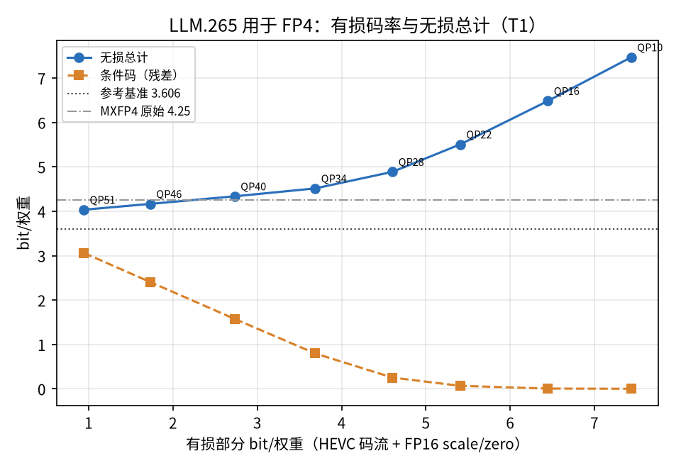

# 012 补充：LLM.265 的复现及 FP4 实验（有损原版 + 无损改造）

论文：Ceyu Xu 等，"LLM.265: Video Codecs are Secretly Tensor Codecs"，MICRO 2025（DOI 10.1145/3725843.3756078）。
官方代码：https://github.com/Entropy-xcy/llm.265（commit 见 [refs.md](refs.md)）。代码在 [llm265/](llm265/)，结果在 [results/llm265/](results/llm265/)。

本文只看压缩部分，不涉及吞吐和硬件设计。

## 1. 论文的压缩流程

论文正文（第 3.2、4.1 节）和官方代码（`pytorch_nvenc/utils/eval_compress_quarot_model_variable_bitrate*.py`、`pytorch_nvenc/pipeline/`）给出的权重压缩流程：

1. 旋转（只在代码里有）：先对整个模型做 QuaRot 旋转（融合 LayerNorm，乘 Hadamard 矩阵）。论文的权重压缩章节没有写这一步。
2. 8 bit 量化（`CWQuantization`）：每一行做 min-max 非对称量化到 0–255，scale = (max − min)/255，zero = round(−min/scale)，用 FP16 保存。q/k/v 与 down_proj 先转置。代码统计码长时不计 scale 和 zero。
3. 切帧（`FixedTiling`）：矩阵切成固定大小的帧（LLaMA 上为 2048×2048），只用亮度通道（NV12 + `monoChromeEncoding`）。每个帧用一个新的编码器实例单独编码，所以全部是帧内编码。
4. HEVC 编码：NVENC，preset P7，tuning HQ，VBR；平均码率是调节旋钮，最大码率为平均码率的 10 倍。实际 bit 数按输出包的大小统计。
5. 按层分配码率：每层的预算 B = k·l + b（l 为层号），搜索 k，用 b 把平均码率调到目标值。
6. 解码、反量化，替换回模型权重，用下游任务准确率评判。

论文图 2(b) 把 8 bit 到 2.6 bit 拆成几步（LLaMA-2-7B 的一个 k_proj，约束 MSE < 0.01）：熵编码 −0.4，DCT 变换与量化 −4.1，帧内预测 −0.6，CTU 划分 −0.3，帧间预测 +0.5（不用）。最大的一步是对变换系数做有损量化。论文没有说明 MSE 是在哪个量纲上算的。

## 2. 本实验的做法

**有损部分（原版）**，[llm265/l265_run.py](llm265/l265_run.py)：
- 输入：反量化后的 FP4 矩阵（码值 × 2^(E−127)），与 SeedLM S3-a 相同。原文的输入是 BF16。
- w2（down projection）先转置，w1、w3（gate、up）不转置，与原代码对 down_proj、gate/up_proj 的处理一致；转置后都是 2304×5120，按行量化。
- 每行 min-max 量化到 uint8，scale、zero 存为 FP16。
- 切成 4 帧，每帧 2304×1280（原代码用 2048×2048；5120 不是 2048 的倍数，改帧宽后不需要填充）。
- 每帧单独用 NVENC HEVC 编码（ffmpeg 7.1.1 的 `hevc_nvenc`，GPU 1），preset P7、tuning HQ、不用 B 帧。
- 用 ffmpeg 的软件 HEVC 解码器解码（标准解码，逐位确定）；每个码流独立解码两次，两次结果必须相同。
- 反量化得到近似矩阵 Ŵ。

**无损部分（改造）**，与 SeedLM S3-b 完全相同：
- 真实码值（R10 合并后 15 个符号）按行优先顺序用自适应计数模型编码（Dirichlet 1/2），上下文是“Ŵ 在本块 scale 的 FP4 格点上的区间（内部区间再分 S 份）× 块 scale 字节 E”。
- S ∈ {1, 2, 4, 8, 16} 在 train8 上按每个 QP 分别选，再用到 T1；T1 上用 racoder.c 真实编码、解码并逐位比较。
- 总码长 = HEVC 码流 + 每行 FP16 scale/zero（32 bit/行）+ 条件码 + 008 的 scale 流；净收益 = 参考基准 − 总码长。

**与原版的差别**：

| 项目 | 原版 | 本实验 | 原因 |
|---|---|---|---|
| 输入 | BF16 权重 | 反量化后的 FP4 值 | 本项目的数据是 FP4 |
| QuaRot 旋转 | 代码里有，论文没写 | 未做 | 需要整模型改写（融合 LayerNorm、在线旋转激活）；单矩阵上没有对应物。结果按“论文正文版本”报告 |
| 码率控制 | VBR，平均码率为旋钮 | 固定 QP 扫描 | 通过 ffmpeg，单帧码流的 VBR 不理会目标码率（合成数据上 0.25–4 bit/权重的目标都得到 3.5 bit/权重），最大码率超过约 800 Mbit/s 会被拒绝；单帧 VBR 最终也是选一个 QP。报告的都是实际码长 |
| 按层分配码率 | B = k·l + b，按准确率搜索 k | 所有矩阵用同一个 QP | 搜索 k 需要模型准确率评测，超出本实验范围 |
| 单色编码 | NV12 + `monoChromeEncoding` | NV12，色度平面恒为 128，其码长计入 | ffmpeg 不提供单色 HEVC；恒定色度几乎不占码长（见 3.1） |
| scale/zero 的开销 | 不计 | 计入，并单独列出 | 按完整产物计费 |
| 帧大小 | 2048×2048 | 2304×1280 | 矩阵形状不同 |

## 3. 结果

数据：T1（DeepSeek 第 0、13、26、39 层，24 个矩阵，2.83 亿个权重）；S 在 train8（8 个矩阵）上选。逐矩阵结果在 `results/llm265/l265_T1.jsonl`、`l265_train8.jsonl`，汇总在 `l265_summary_T1.json`，由 [llm265/l265_summary.py](llm265/l265_summary.py) 生成。单位都是 bit/权重。

### 3.1 合成数据检查

- 码率控制：一个 2304×1280 的 i.i.d. 高斯帧，用 VBR、目标 0.25、0.5、1、2、3、4 bit/权重编码，实际都是约 3.5 bit/权重；目标 6 时最大码率超出 NVENC 的上限，编码器拒绝初始化。换成固定 QP 后码长随 QP 单调变化（QP 0：9.69，QP 22：5.60，QP 40：2.91）。所以扫描用固定 QP。
- 恒定色度的开销：同一个真实帧用 x265 分别按单色（4:0:0）和 4:2:0（色度恒为 128）编码，在 QP 10、22、34、46 下相差 +0.033、−0.037、+0.005、+0.0001 bit/权重，方向不固定，说明色度平面基本不占码长。
- 关于论文的 “MSE < 0.01”：在 uint8 量纲上，i.i.d. 高斯帧要 QP 0、约 9.7 bit/权重才能做到 MSE 0.016，所以论文的 MSE 不是在 uint8 量纲上算的。

### 3.2 T1：有损码率与无损总计

| 设置 | 有损：HEVC 码流 | 有损：加 FP16 scale/zero | 相对 MSE | MSE（uint8 量纲） | 码值改变 | S | 条件码（残差） | scale 流 | **无损总计** | 相对参考基准 |
|---|---:|---:|---:|---:|---:|---:|---:|---:|---:|---:|
| 8 bit 直存（不经 HEVC） | 8.0000 | 8.0062 | 0.00008 | 0 | 0.00% | 2 | 0.0009 | 0.0308 | 8.0379 | −4.4323 |
| QP 10 | 7.4296 | 7.4358 | 0.00036 | 0.345 | 0.01% | 2 | 0.0018 | 0.0308 | 7.4684 | −3.8628 |
| QP 16 | 6.4410 | 6.4473 | 0.00083 | 0.879 | 0.09% | 8 | 0.0063 | 0.0308 | 6.4843 | −2.8787 |
| QP 22 | 5.4015 | 5.4077 | 0.00217 | 2.395 | 1.97% | 16 | 0.0681 | 0.0308 | 5.5066 | −1.9010 |
| QP 28 | 4.5972 | 4.6034 | 0.00555 | 6.189 | 8.25% | 16 | 0.2532 | 0.0308 | 4.8875 | −1.2818 |
| QP 34 | 3.6799 | 3.6862 | 0.01730 | 19.19 | 26.92% | 16 | 0.7974 | 0.0308 | 4.5143 | −0.9087 |
| QP 40 | 2.7249 | 2.7312 | 0.05536 | 61.32 | 50.56% | 16 | 1.5746 | 0.0308 | 4.3366 | −0.7309 |
| QP 46 | 1.7239 | 1.7302 | 0.17734 | 196.7 | 69.87% | 16 | 2.4050 | 0.0308 | 4.1660 | −0.5604 |
| QP 51（最大） | 0.9347 | 0.9409 | 0.44976 | 504.0 | 81.55% | 16 | 3.0622 | 0.0308 | **4.0339** | −0.4283 |

说明：
- “相对 MSE” = ‖W − Ŵ‖² / ‖W‖²，W 是反量化后的 FP4 矩阵；“码值改变”是 Ŵ 四舍五入到本块 FP4 格点后与原码值不同的比例（与 SeedLM S3-a 同一口径）。
- 全部 24 个矩阵、9 个设置：HEVC 码流两次独立解码都相同，条件码都逐位还原（`roundtrip_ok` 全为真）。
- 参考基准（链式 + R9c，含 scale 流）是 3.6056；MXFP4 原始存储是 4.25。
- 逐矩阵看，没有一个矩阵在任何 QP 下有正的净收益；QP 51 时各矩阵的净收益在 −0.50 到 −0.36 之间。w1、w2、w3 之间相差不到 0.02。
- 8 bit 量化这一步本身几乎不丢 FP4 的信息：不经 HEVC 时只有 0.00% 的码值改变，残差只要 0.0009 bit/权重。

### 3.3 与论文的 2.9 bit 对照

- 论文的权重平均码率在 2.88–3 bit 附近（LLaMA-3-70B 2.88，LLaMA-2-7B 约 3）。T1 上与之最接近的是 QP 40：有损部分 2.73 bit/权重（加 scale/zero 2.73），相对 MSE 5.5%，一半的码值被改到别的格点。
- 作为 FP4 的有损压缩器，HEVC 要到 4.6 bit/权重（QP 28）才能把改变的码值压到 8% 左右，这已经超过 FP4 原样存储的 4.25 bit（改变 0%）。
- 这里没有做准确率评测，所以不能说这些误差对模型的影响有多大；只能说在码值层面，HEVC 的有损结果和原来的 FP4 码值差得很远。

## 4. 结论

1. 论文所说的 2.9 bit 是有损码率：在 FP4 上，同等码率（QP 40，2.73 bit/权重）让 50.6% 的码值改变。
2. 改成无损后，全部 9 个设置都比参考基准差，最好的是 QP 51，总计 4.0339，差 0.4283，也比 MXFP4 原始的 4.25 只少 0.22。
3. 原因是 HEVC 每多花 1 bit，残差最多只省 0.83 bit：QP 51→46 有损部分多 0.79、残差少 0.66；QP 46→40 多 1.00、少 0.83；QP 40→34 多 0.96、少 0.78；QP 34→28 多 0.92、少 0.54。码率越高，换来的越少。
4. 在扫描的范围内，有损部分越少，总计越低；有损部分趋于 0 时，总计会趋于“只用块 scale 作上下文的条件码 + scale 流”，接近参考基准。这与 SeedLM S3-b 的情况相同：近似部分加残差，合计没有低于直接对码值建模。
5. 没有复现的部分：官方代码的 QuaRot 旋转、按层分配码率（B = k·l + b）、准确率评测。它们会怎样改变上面的数字没有实测，影响未知。

